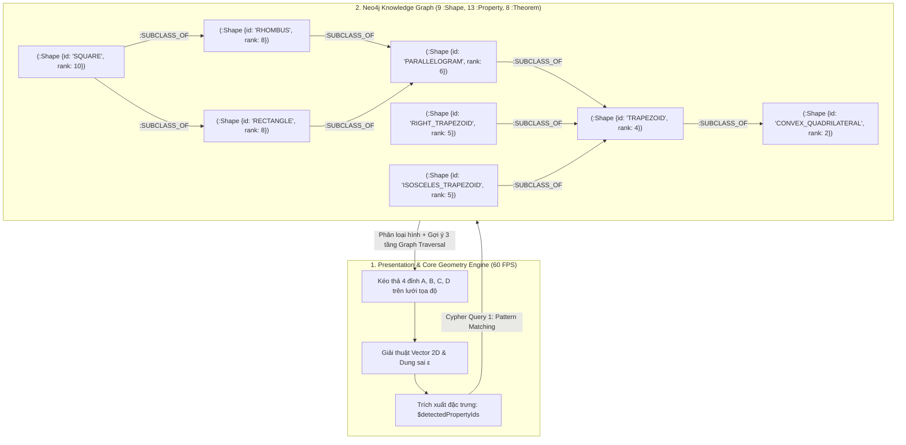

# QuadGeo Neo4j — Ứng dụng Hỗ trợ Học Toán Hình học phẳng (Chuyên đề Tứ giác)

> **Dự Án Cuối Chương Neo4j — Làm theo nhóm (Nhóm 4)**  
> **Giảng viên hướng dẫn:** Thầy Trần Bình  
> **Học phần:** Cơ sở dữ liệu NoSQL / Đồ thị Neo4j  

---

## 📌 Danh mục 4 hạng mục bàn giao (Deliverables Checklist)

Kho lưu trữ này được tổ chức đầy đủ và đối sánh trực tiếp với 4 yêu cầu đánh giá của đồ án:

1. **Hồ sơ đặc tả yêu cầu phần mềm (SRS):**
   - Bản gốc Microsoft Word: [`docs/Nhóm 4_SRS.docx`](./docs/Nhóm%204_SRS.docx)
   - Bản đọc trực tiếp trên GitHub: [`docs/SRS_HO_SO_DAC_TA.md`](./docs/SRS_HO_SO_DAC_TA.md)
2. **Product Backlog & Kế hoạch Sprint (Agile/Scrum):**
   - Bảng 15 User Stories (chuẩn Gherkin `Given - When - Then`) & 4 Sprints: [`docs/PRODUCT_BACKLOG.md`](./docs/PRODUCT_BACKLOG.md)
3. **Mã nguồn dự án & Kịch bản Cypher Neo4j:**
   - Kịch bản khởi tạo Constraints, Indexes, Seed Knowledge Graph và Core Cypher Queries: [`neo4j/scripts/`](./neo4j/scripts/)
   - Core Geometry Engine & Bộ kiểm thử Unit Test độc lập: [`src/engine/`](./src/engine/), [`tests/test_geometry_engine.py`](./tests/test_geometry_engine.py)
   - Giao diện tương tác HTML5 Canvas 60fps & Trực quan hóa Đồ thị: [`public/`](./public/)
   - Backend API Server (hỗ trợ cả Python Flask và Node.js Express): [`app.py`](./app.py), [`server.js`](./server.js)
4. **Tài liệu Hướng dẫn cài đặt & sử dụng:**
   - Cẩm nang hướng dẫn chi tiết từng bước: [`HUONG_DAN_SU_DUNG.md`](./HUONG_DAN_SU_DUNG.md)

---

## 🚀 Cách chạy nhanh dự án trong 30 giây

### Trên Windows (Nhanh nhất)
Nhấp đúp vào file **`run.bat`** trong thư mục gốc của dự án, sau đó mở trình duyệt tại địa chỉ:
👉 **`http://localhost:3000`**

### Hoặc chạy qua dòng lệnh (Terminal / PowerShell)
```bash
# 1. Cài đặt các thư viện cần thiết
pip install -r requirements.txt

# 2. Chạy bộ Unit Test kiểm tra Core Geometry Engine (13 kịch bản toán học)
python tests/test_geometry_engine.py

# 3. Khởi động ứng dụng
python app.py
```

---

## 🧠 Kiến trúc Đồ thị Tri thức Neo4j (Knowledge Graph Architecture)



---

## ⚡ Các tính năng nổi bật đã hoàn thiện

- **Tương tác hình học động 60 FPS (`US-01`, `US-04`, `US-07`, `US-08`):** Kéo thả 4 đỉnh $A, B, C, D$ mượt mà, bắt điểm lưới thông minh `Snap-to-grid` (bán kính 10px), hỗ trợ góc vuông `Snap-to-90°`, tự động vẽ ký hiệu góc vuông, vạch cạnh bằng nhau, mũi tên cạnh song song và giao điểm hai đường chéo.
- **Xử lý chặt chẽ các trường hợp ngoại lệ (`US-02`, `US-03`):** Tự động phát hiện và cảnh báo đỏ khi tứ giác tự cắt (`INVALID_SELF_INTERSECTING`) hoặc suy biến khi 3 đỉnh thẳng hàng / 2 đỉnh trùng nhau (`INVALID_DEGENERATE`).
- **Phân loại tứ giác tự động bằng Cypher Pattern Matching (`US-06`):** Khớp mẫu tập thuộc tính hình học với đồ thị Neo4j để nhận diện chính xác 9 cấp độ hình tứ giác theo thứ tự ưu tiên `rank` từ cao xuống thấp, kèm khung **Live Cypher Inspector** hiển thị câu truy vấn thực tế.
- **Bài tập thực hành dựng hình & Gợi ý 3 tầng bằng Graph Traversal (`US-10`, `US-11`):**
  - *Tầng 1:* Gợi ý khái niệm lý thuyết và định lý SGK Toán 8 còn thiếu.
  - *Tầng 2:* Gợi ý thao tác di chuyển đỉnh cụ thể trên lưới.
  - *Tầng 3:* Gợi ý tọa độ chuẩn và hiển thị hình mẫu đối chiếu ngay trên Canvas.
- **Trắc nghiệm lý thuyết liên kết đồ thị (`US-09`):** Chấm điểm tự động và hiển thị đường dẫn chứng minh định lý `(:Property) <-[:REQUIRES]- (:Theorem) -[:CONCLUDES]-> (:Shape)`.
- **Xác thực JWT, Lưu vết học tập `(:User)-[:SOLVED]->(:Exercise)` & Xuất ảnh PNG (`US-12`, `US-13`, `US-14`):** Quản lý tiến độ làm bài của học sinh trên đồ thị và xuất phiếu kết quả bài làm ra ảnh `.png` sắc nét.

👉 Xem chi tiết cách sử dụng từng chức năng tại file: **[`HUONG_DAN_SU_DUNG.md`](./HUONG_DAN_SU_DUNG.md)**.
